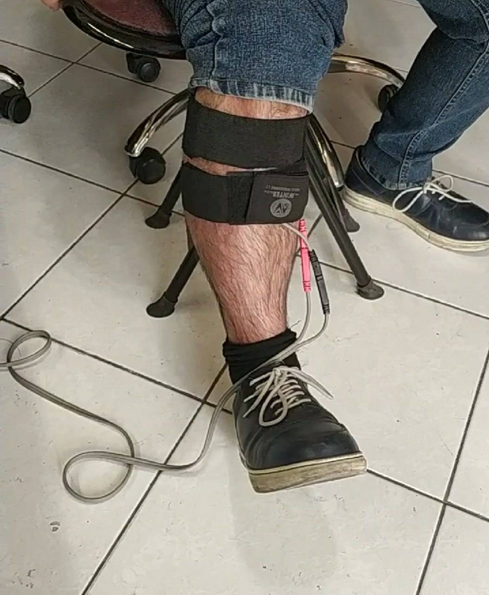
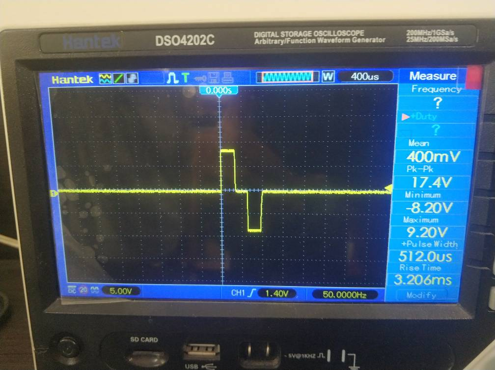
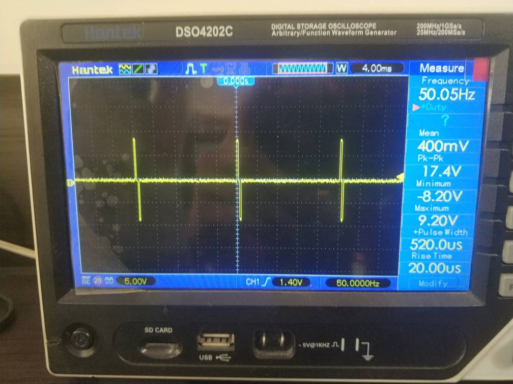

# High-Voltage Biphasic Functional Electrical Stimulator (FES)

> A medical-grade hardware driver and bare-metal firmware implementation of a high-voltage biphasic stimulator designed for upper motor neuron rehabilitation (foot-drop correction). Developed as the core hardware stage of the **ParaWalk** neuro-prosthetic initiative during my R&D engineering internship at **DigiMind** (affiliated with my B.Sc. program at **Sharif University of Technology**).

---

## 📌 Project Overview & Clinical Background

Drop foot is a debilitating gait abnormality resulting from neurological impairments (e.g., Stroke, Multiple Sclerosis, or incomplete Spinal Cord Injury) characterized by the inability to dorsiflex the foot during the swing phase. 

**Functional Electrical Stimulation (FES)** applies synchronized electrical current to the common peroneal nerve to restore functional foot dorsiflexion. In compliance with **IEC 60601-2-10** safety requirements, direct current (DC) application to human tissue is strictly prohibited due to electrolytic breakdown and electrochemical burns. Hence, this project implements a **symmetrical, biphasic, charge-balanced** waveform (zero net charge, Net Charge ≈ 0) ensuring no ionic charge accumulation at the skin-electrode interface.

---

## 🔬 R&D Phase: Gait Sensing & Processor Trade-Off Analysis

### 1. Gait Phase Detection Sensor Benchmarking
To establish a closed-loop neuro-prosthesis, a comprehensive parametric trade-off study was conducted across candidate sensing modalities:

| Sensor Type | Output / Interface | Latency & Dynamics | Vulnerabilities & Trade-offs | Decision |
| :--- | :--- | :--- | :--- | :--- |
| **FSR (Force Sensing Resistor)** | Analog (ADC) | Zero latency; detects Heel Strike (HS) & Toe Off (TO) | Mechanical fatigue after cyclic loading; ground-surface dependency | Complementary |
| **6-Axis IMU (MPU Series)** | Digital (I2C/SPI) | Continuous angular velocity & acceleration tracking | **Mathematical Integration Drift** during prolonged walking | **Primary Selection** |
| **sEMG** | Differential Bio-amp | Pre-movement intent detection | Amplifier saturation by 80V stimulation artifacts; complex shielding | Rejected for PoC |
| **Optical ToF / Ultrasonic** | Digital / Timer | Direct distance to floor | Bulky ergonomics; optical absorption on wet/dark surfaces | Rejected |
| **Mercury Tilt Switch** | Digital Interruption | Binary contact | High bouncing noise; biological mercury hazard | Rejected |

> **Hybrid Synthesis:** To eliminate IMU integration drift without computationally heavy Kalman filters on low-power nodes, a hybrid strategy was conceptualized where an in-shoe FSR provides ground-truth interrupts (resetting drift: θ_corrected(t_HS) = 0) while an IMU captures swing-phase trajectory dynamics.

---

### 2. Processing Platform Evaluation
- **STM32F4 Discovery (Initial Prototyping):** High computational margin (Cortex-M4, FPU) utilized during preliminary desktop evaluation.
- **STM32F030 (Low-Power Edge Target):** Selected for the current hardware implementation to demonstrate deterministic microsecond timing and minimal BOM cost for battery-powered wearable devices.
- **Future Commercial Target:** Microcontrollers featuring dual 12-bit DACs (e.g., STM32G4 series) for arbitrary pulse shaping and dynamic active compliance voltage adaptation.

---

## ⚡ Hardware Architecture & Circuit Design

The high-voltage power stage switches up to **80V DC** to deliver therapeutic pulses across transcutaneous electrodes:

1. **Full H-Bridge Topology:**
   - **High-Side Switches:** P-Channel Power MOSFETs (`IRF9640`, V_DS = -200V).
   - **Low-Side Switches:** N-Channel Power MOSFETs (`IRF540` / `FQP18N50C`).
2. **High-Voltage Level Shifters:**
   - Driven by high-voltage BJT transistors (`2N5551`, V_CEO = 160V) with 12V Zener clamping networks to constrain V_GS within safe operating limits (preventing gate oxide breakdown from the 80V rail).
3. **Bleeder & Snubber Networks:**
   - Dual bleeder networks (4.7 kΩ, 2W) bleed parasitic capacitance (C_oss) to achieve clean fall times (t_f < 5 µs).
4. **Galvanic Isolation:**
   - High-speed 10 MBd optocouplers (`6N137`) maintain total electrical isolation between the sensitive 3.3V digital logic and the floating 80V power domain.

---

## 💻 Bare-Metal Firmware Implementation

Deterministic switching without software jitter is executed on an **STM32F030C8T6** running at 48 MHz (PLL x12 via internal HSI):

- **Hardware Timer (TIM3):** Configured with Prescaler = 47, yielding exactly **1 µs per tick**.
- **Timing Profile:**
  - **Cathodic Phase (T_pos):** 250 µs pulse width via `PA0`.
  - **Dead-Time Insertion (T_dead):** Dedicated **40 µs blanking window** ensuring full MOSFET gate discharge and preventing catastrophic shoot-through.
  - **Anodic Phase (T_neg):** 250 µs charge-balancing pulse via `PA1`.
  - **Stimulation Frequency:** 25 Hz repetition rate (Period = 40 ms).

---

## 📊 Experimental Results & In-Vivo Hardware Validation

Following the initial hardware architecture and deterministic firmware design, the complete system underwent benchtop load characterization and in-vivo neuromuscular trials:

### 1. In-Vivo Neuromuscular Stimulation & Electrode Configuration
Transcutaneous hydrogel electrodes were positioned over the **common peroneal nerve** (near the fibular neck) and the motor point of the **tibialis anterior muscle** to stimulate the dorsiflexor muscle group:

  

- **Targeted Anatomy:** Common Peroneal Nerve & Tibialis Anterior belly.
- **Functional Outcome:** Verified controlled, balanced foot dorsiflexion without sensory discomfort or cutaneous burns, validating compliance with **IEC 60601-2-10** charge-balance criteria.

---

### 2. High-Voltage Symmetrical Biphasic Pulse Verification
The output waveform across the biological load was captured using a digital storage oscilloscope:

  

> ⚠️ **Oscilloscope Probe Scaling Note:**  
> The measurement was conducted using a passive **10x probe attenuation factor (10:1 ratio)**. Consequently, the displayed oscilloscope vertical scale of **5.00V/div** (measuring ~8.2V to 9.2V on-screen amplitude) corresponds directly to an actual physical output pulse amplitude of **~80V** across the stimulated tissue.

- **Phase Symmetries:** Verified symmetric cathodic ($T_{pos} \approx 250\,\mu\text{s}$) and anodic ($T_{neg} \approx 250\,\mu\text{s}$) phases.
- **Dead-Time Clearance:** Dedicated **$40\,\mu\text{s}$ blanking window** clearly visible at zero-crossing, validating that high-side and low-side switches never conduct simultaneously.
- **Edge Dynamics:** Rise and fall times constrained ($t_r, t_f < 5\,\mu\text{s}$) via active bleeder networks.

---

### 3. Continuous Stimulation Pulse Train (Repetition Rate)
To evaluate steady-state thermal and switching stability, continuous pulse trains were monitored under sustained operation:

  

- **Frequency Stability:** Deterministic **25 Hz repetition rate** ($T_{period} = 40\,\text{ms}$) generated by hardware timer interrupts without baseline wander or jitter.
- **DC Balance:** Zero baseline drift ($\int I(t)dt \approx 0$) ensuring total prevention of charge accumulation at the skin-electrode interface.

---

## 🚀 Roadmap & Future Milestones
- [ ] Integration of constant-current active feedback regulation (replacing voltage-controlled topology).
- [ ] Firmware porting to dual-DAC STM32 platform for arbitrary waveform modulation.
- [ ] Integration of 6-axis IMU over I2C with hardware gait-phase interrupt processing.

---

## 👤 Author
**Arshia Abazari**  
B.Sc. in Electrical Engineering (Digital Systems), Sharif University of Technology  
- **Email:** [a.abazri002@gmail.com](mailto:a.abazri002@gmail.com)  
- **LinkedIn:** [Arshia Abazari](https://linkedin.com)